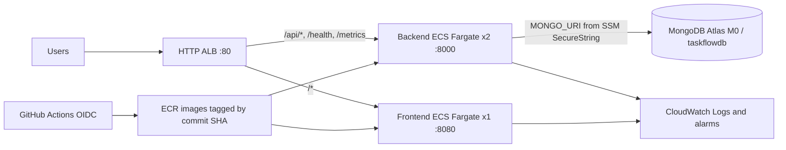

# TaskFlow on AWS ECS

TaskFlow is a small FastAPI + MongoDB API and React SPA deployed as two ECS Fargate services. Terraform provisions the AWS and Atlas infrastructure; GitHub Actions builds and deploys images through GitHub OIDC.

## Architecture



| Area | Choice |
|---|---|
| Region and cluster | `ap-south-1`, `taskflow-cluster` |
| Compute | Fargate, 256 CPU / 512 MB; backend 2 tasks, frontend 1 |
| Network | Default VPC, public ALB; backend/frontend ingress restricted to ALB security group |
| Database | Atlas M0, `taskflowdb`; URI stored in SSM Parameter Store SecureString |
| Monitoring | 7-day ECS log retention; CloudWatch 5xx, p95 latency, and unhealthy-target alarms |

The ALB is HTTP-only. Atlas access uses `0.0.0.0/0` because the free M0 deployment has no fixed egress IP here; this is a documented cost/security trade-off. See [ANSWERS.md](ANSWERS.md).

## Run locally

```sh
docker compose up --build -d
curl -i http://localhost:8000/health
curl -i http://localhost:8000/api/items
docker compose down -v
```

The backend requires `MONGO_URI`; `MONGO_DB` defaults to `taskflowdb`. The compose stack is for local development and uses the configured MongoDB URI.

## CI/CD

Pull requests to `main` run Ruff, pytest, no-push builds for both images, and Terraform formatting/validation. A push to `main` assumes the deployment role with OIDC, pushes `linux/amd64` images tagged with the commit SHA and `latest`, registers ECS task definitions, updates both services, and waits for stability.

Merged PR: [#1](https://github.com/Salil-Dev1/aws-ecs-sre-platform/pull/1) · Passing [CI](https://github.com/Salil-Dev1/aws-ecs-sre-platform/actions/runs/46020243916) · Final passing [CD](https://github.com/Salil-Dev1/aws-ecs-sre-platform/actions/runs/46025030863).

## Evidence

- [CloudWatch alarm history](evidence/alarm-history.json)
- [CloudWatch 5xx alarm screenshot](evidence/screenshots/cloudwatch-5xx-alarm.png)
- [GitHub Actions CD screenshot](evidence/screenshots/github-actions-cd.png)

The two screenshot paths are referenced for evidence collection; those image files were not present in this checkout.
